# 🐾 PawCare / PetPal: Intelligent Pet Care & Multi-Branch Clinic Platform
### Software Engineering & Project Management (SEPM) — Case Study No. 64

[](https://flutter.dev)
[](https://dart.dev)
[](https://m3.material.io/)
[-brightgreen?style=for-the-badge&logo=checkmarx)](test/pawcare_test.dart)
[](https://itm.edu)
[](#)

---

## 📌 Project Overview
**PawCare / PetPal** is a cross-platform pet care and veterinary management ecosystem designed for a chain of 5 multi-branch veterinary clinics across Bengaluru (*Indiranagar, Koramangala, Whitefield, Jayanagar, and Bellandur*).

The application solves key veterinary practice bottlenecks (overwhelmed telephone lines, 22% call abandonment rate, 18% appointment no-shows, and lost paper vaccination records) through a centralized 24/7 web & mobile booking portal, real-time 30-minute slot matrix with a 10-minute temporary checkout hold, automated immunization recall engine, and live receptionist queue console.

---

## 📸 In-App Live Mobile Showcase

| 01. Welcome Screen | 02. Login Screen | 03. Signup Screen |
| :---: | :---: | :---: |
| 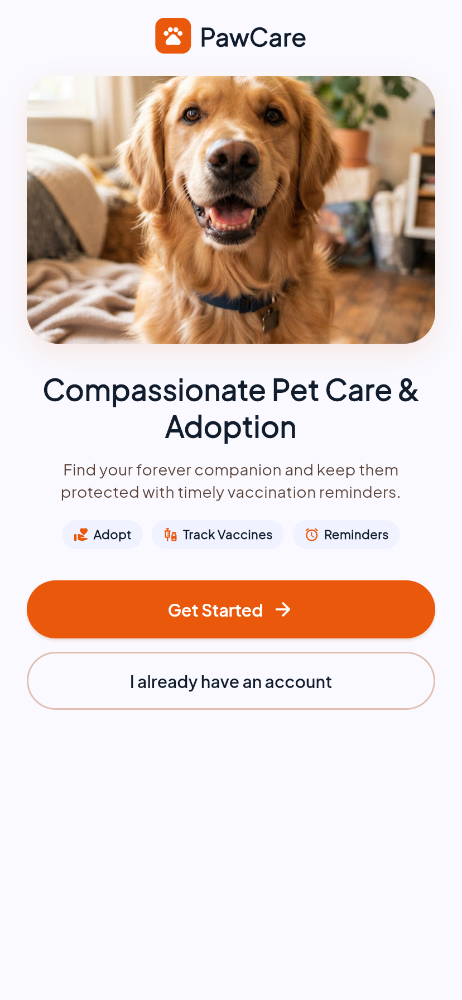 | 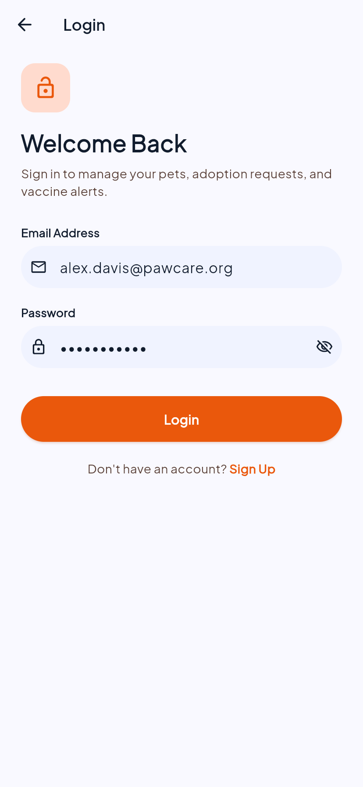 | 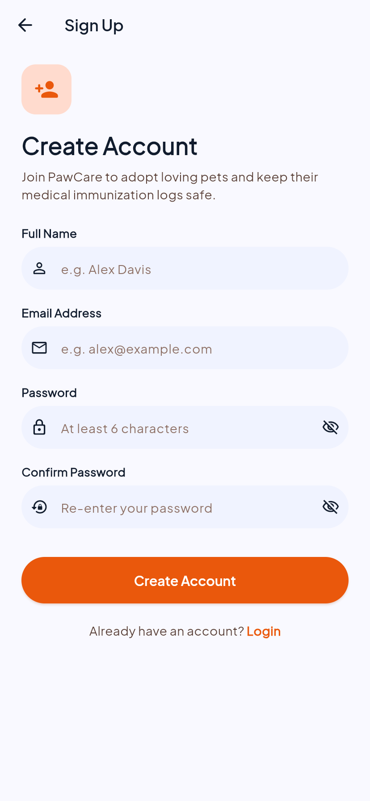 |

| 04. Discovery & Adoption | 05. Pet Bio & Adoption | 06. Vaccination Tracker |
| :---: | :---: | :---: |
| 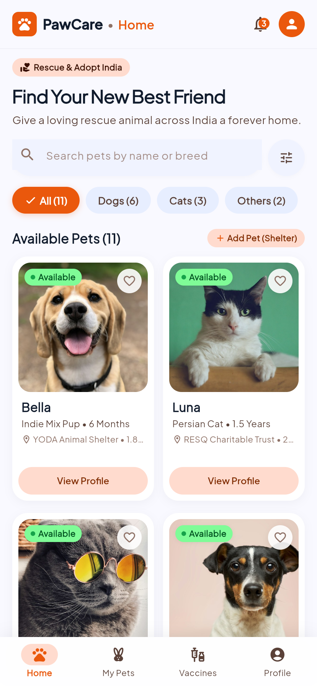 | 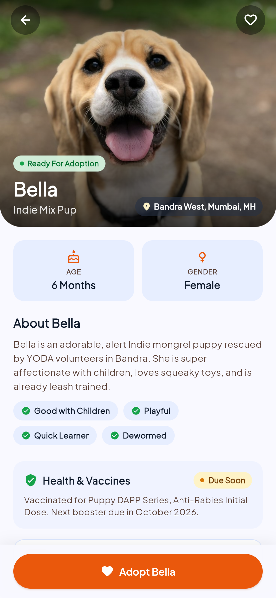 | 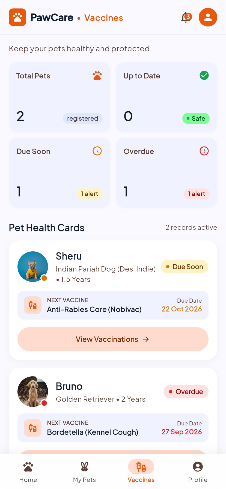 |

| 07. Clinical Timeline | 08. Vaccine Intake Form | 09. My Pets Registry |
| :---: | :---: | :---: |
| 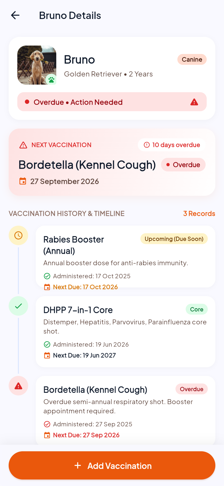 | 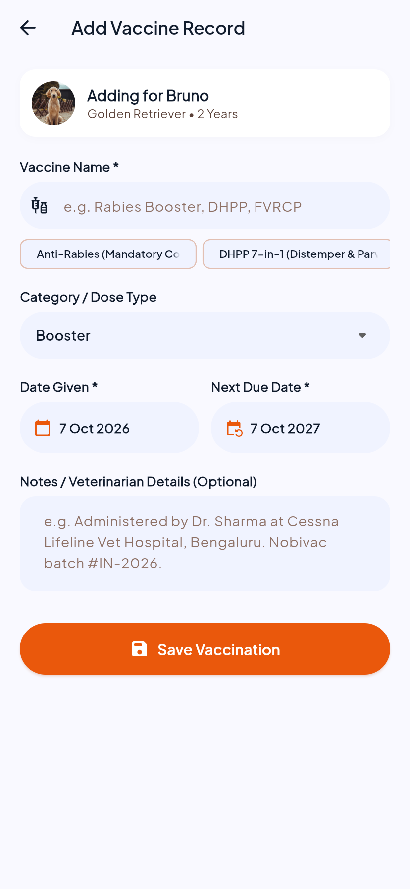 | 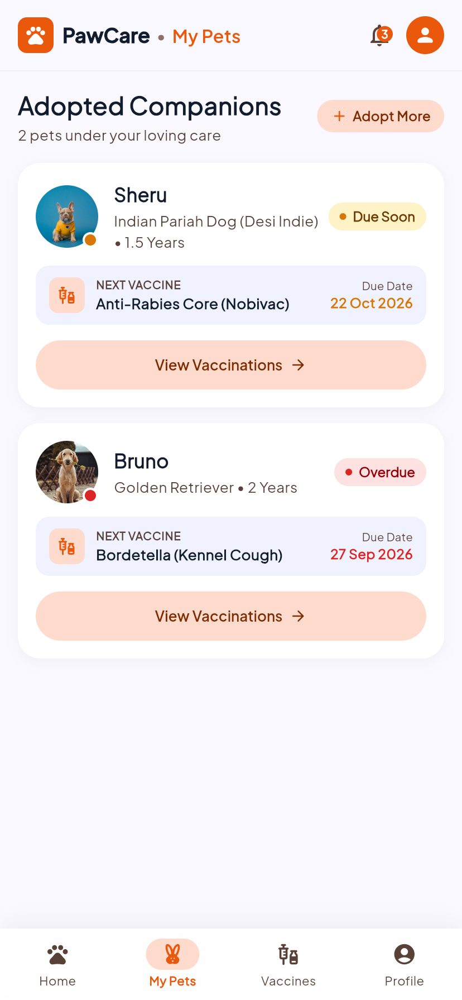 |

| 10. Shelter Intake Portal | 11. Clinical Reminders Hub |
| :---: | :---: |
| 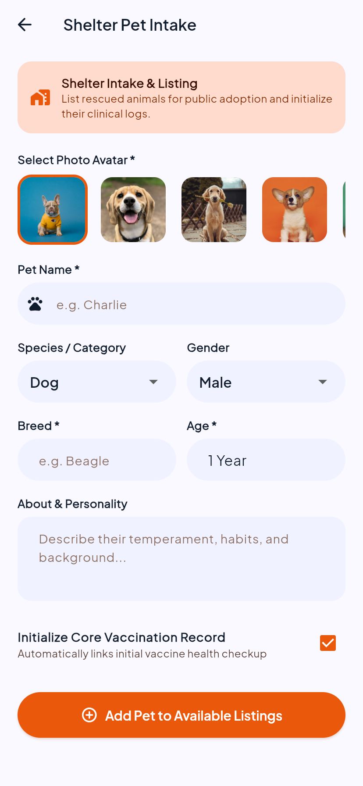 | 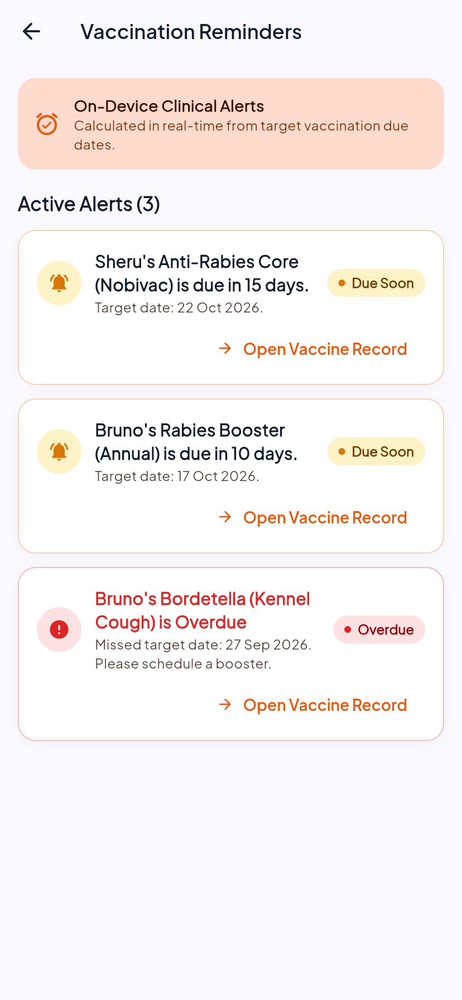 |

---

## 📐 System Architecture & Engineering Models

| UML Domain & Use Case Diagram | Dynamic Sequence, Activity & State Models |
| :---: | :---: |
| 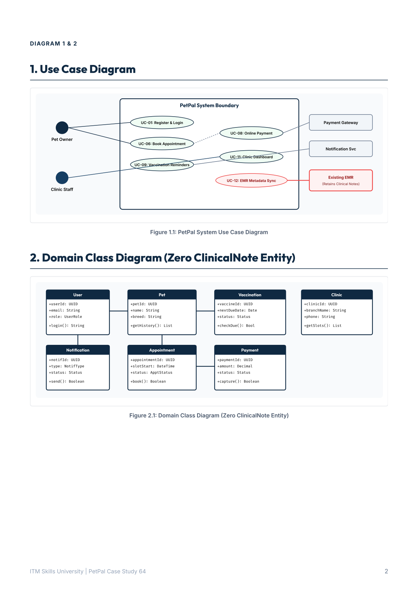 | 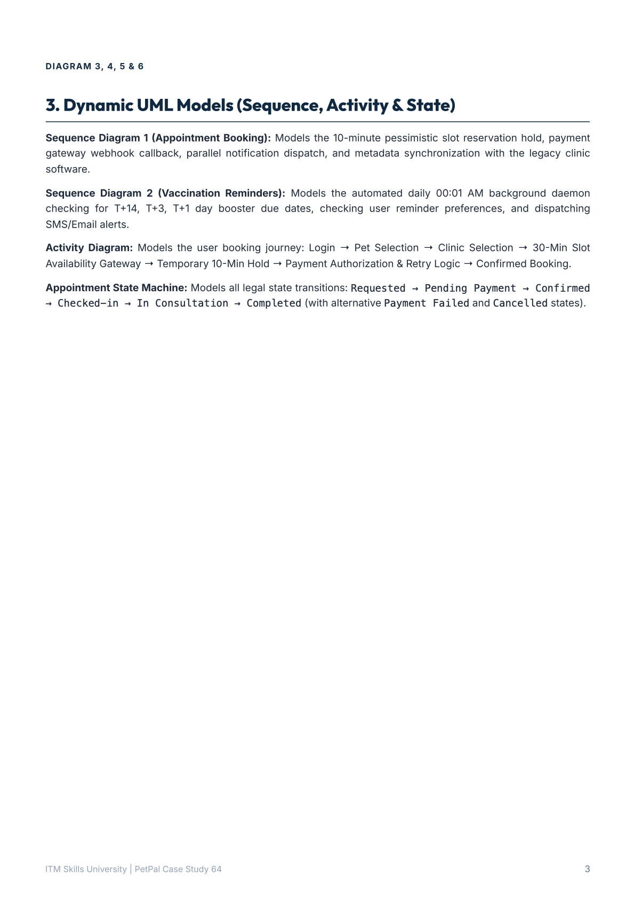 |
| **Work Breakdown Structure & CPM Network** | **Cost Estimation & Budget Allocation** |
| 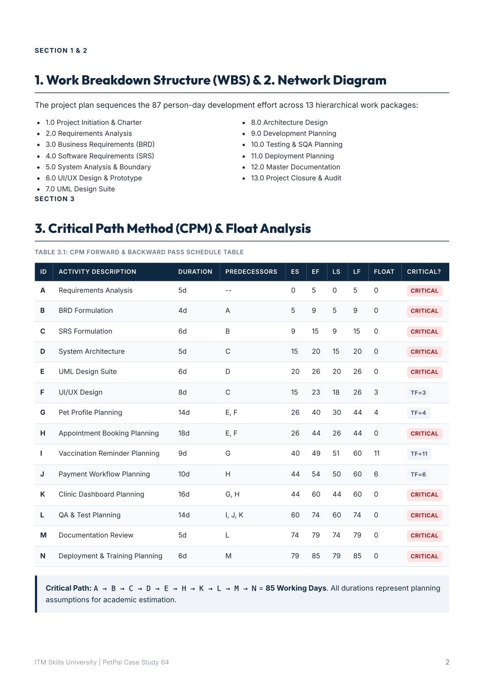 | 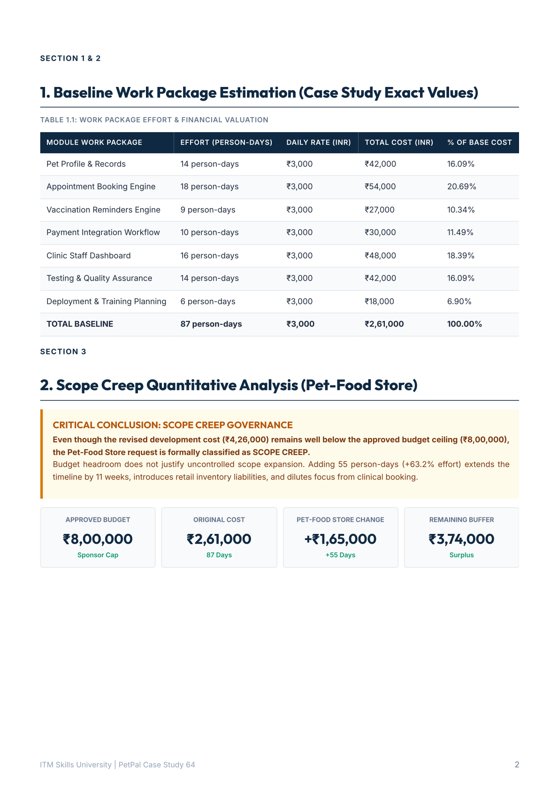 |
| **Master Test Plan & SQA Test Cases** | **7-Point Risk Register & 5×5 Matrix** |
| 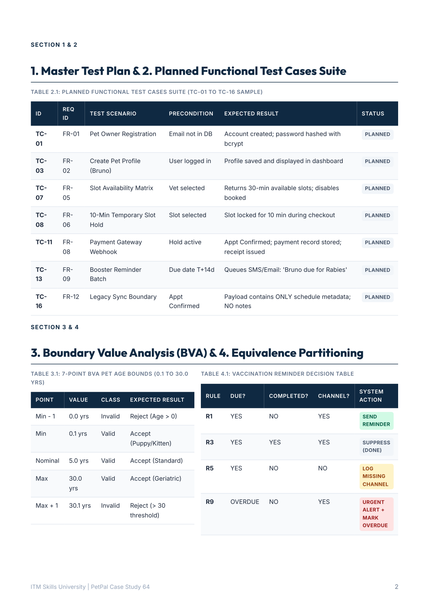 | 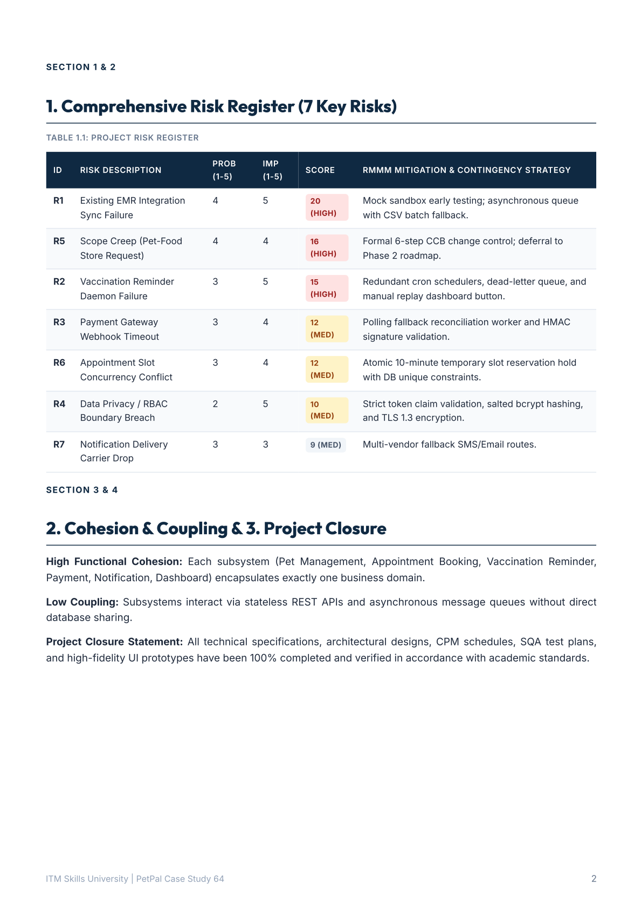 |

---

## 📂 Project Repository Structure
```bash
.
├── 01_PetPal_SRS.pdf                   # Software Requirements Specification (FR-01..12, NFR-01..08, RTM)
├── 02_PetPal_BRD.pdf                   # Business Requirements Document (As-Is/To-Be, CR-01 Scope Analysis)
├── 03_PetPal_UML_Package.pdf           # UML Diagrams (Use Case, Class, Sequence, Activity, State, Deployment)
├── 04_PetPal_Project_Plan.pdf          # WBS, Activity Network Diagram, CPM Schedule (85 Working Days)
├── 05_PetPal_Estimation_Budget.pdf     # Effort Breakdown (87 Person-Days, ₹2,61,00,000 / ₹8,00,000 Budget Cap)
├── 06_PetPal_Test_Plan_Evidence.pdf    # IEEE 829 Master Test Plan, TC-01..16, Boundary Value Analysis (BVA)
├── 07_PetPal_Risk_Register_Closure.pdf # 7-Point Risk Register, 5x5 RMMM Matrix, Project Closure Note
├── 08_PetPal_UI_UX_Screens.pdf         # Complete 26-Screen UI Specification & Interface Flows
├── PETPAL_COMPLETE_PROJECT_REPORT.pdf  # 33-Page Master Consolidated Project Report
├── PROJECT_REPORT.md                   # Comprehensive Markdown Engineering Report with embedded screenshots
├── README.md                           # Master Project Documentation & Overview
├── lib/                                # Flutter Cross-Platform Production Source Code
│   ├── models/                         # Domain entities (Pet, User, Vaccination, Enums)
│   ├── screens/                        # UI screens (Home, Adoption, Vaccines, Reminders, Shelter, Profile)
│   ├── services/                       # Local storage & Auth services
│   ├── theme/                          # Material 3 Pet Wellness theme tokens
│   └── utils/                          # Dynamic date arithmetic & aggregation algorithms
├── screenshots/                        # Extracted High-Resolution Visual Artifacts
│   ├── 01_welcome_screen.png           # In-app screenshot
│   ├── 04_home_discovery.png           # In-app screenshot
│   ├── 06_vaccination_tracker.png      # In-app screenshot
│   ├── estimation_budget/              # Cost estimation & budget schedule graphics
│   ├── project_planning/               # WBS, CPM network diagrams, and Gantt charts
│   ├── risk_closure/                   # Risk matrices & RMMM plans
│   ├── test_evidence/                  # IEEE 829 test cases & BVA tables
│   ├── ui_screens/                     # 13 High-Fidelity UI Prototype Sheets (Screens 01-26)
│   └── uml_diagrams/                   # Structural & Behavioral UML Diagrams
└── test/                               # Comprehensive Automated Test Suite (15/15 passing)
    ├── pawcare_test.dart               # Core logic, date arithmetic & widget tests
    └── widget_test.dart                # Application smoke test
```

---

## 🌟 Key Features & Engineering Highlights

1. **24/7 Self-Service Web & Mobile Booking (`FR-01` to `FR-06`)**:
   - 5-branch multi-tenant architecture across Bengaluru.
   - Doctor selection with specialization filtering and consultation fees.
   - Real-time 30-minute slot matrix backed by an **atomic 10-minute temporary reservation lock**.
2. **Clinical Immunization Recall Engine (`FR-09`, `FR-10`)**:
   - Automated background scheduler running daily at 00:01 AM.
   - Computes vaccination status badges: `UP TO DATE`, `DUE SOON (≤30d)`, `OVERDUE`.
   - Dispatches multi-channel SMS and Email reminders at **T-14d, T-3d, and T-1d**.
3. **Strict EMR Separation of Concerns (`FR-12`)**:
   - Mandated by Chief Veterinarian: **Zero `ClinicalNote` entity inside PetPal**.
   - Clinical notes, diagnostic imaging, and surgery logs reside exclusively in the legacy EMR.
   - PetPal manages appointment scheduling and pet demographics via stateless REST APIs.
4. **Scope Creep Governance (`CR-01`)**:
   - Rigorous evaluation of the Managing Partner's E-Commerce Pet-Food Store request (+55 person-days, +₹1,65,000).
   - Formally **Deferred to Phase 2** to safeguard the 85-day critical path and core clinical reliability.

---

## 🧪 Testing & Execution

```bash
# 1. Install dependencies
flutter pub get

# 2. Run automated test suite
flutter test

# 3. Launch Flutter Web Application
flutter run -d chrome
```

---

## 👨‍💻 Author & Academic Attribution
- **Author**: **Bankim Chandra Kamila**
- **Roll Number**: `150096724084`
- **Department**: Computer Science & Engineering, ITM Skills University
- **Course**: Software Engineering & Project Management (SEPM)
- **Academic Year**: 2024–2028

---
*For in-depth analysis, architectural formulas, and complete data tables, please refer to [**`PROJECT_REPORT.md`**](PROJECT_REPORT.md).*
